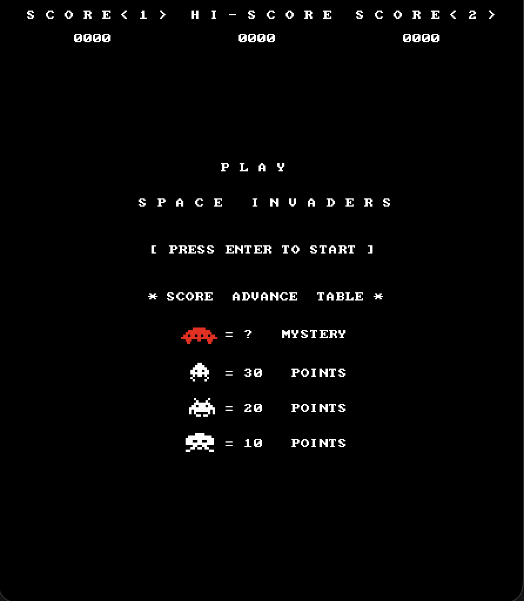
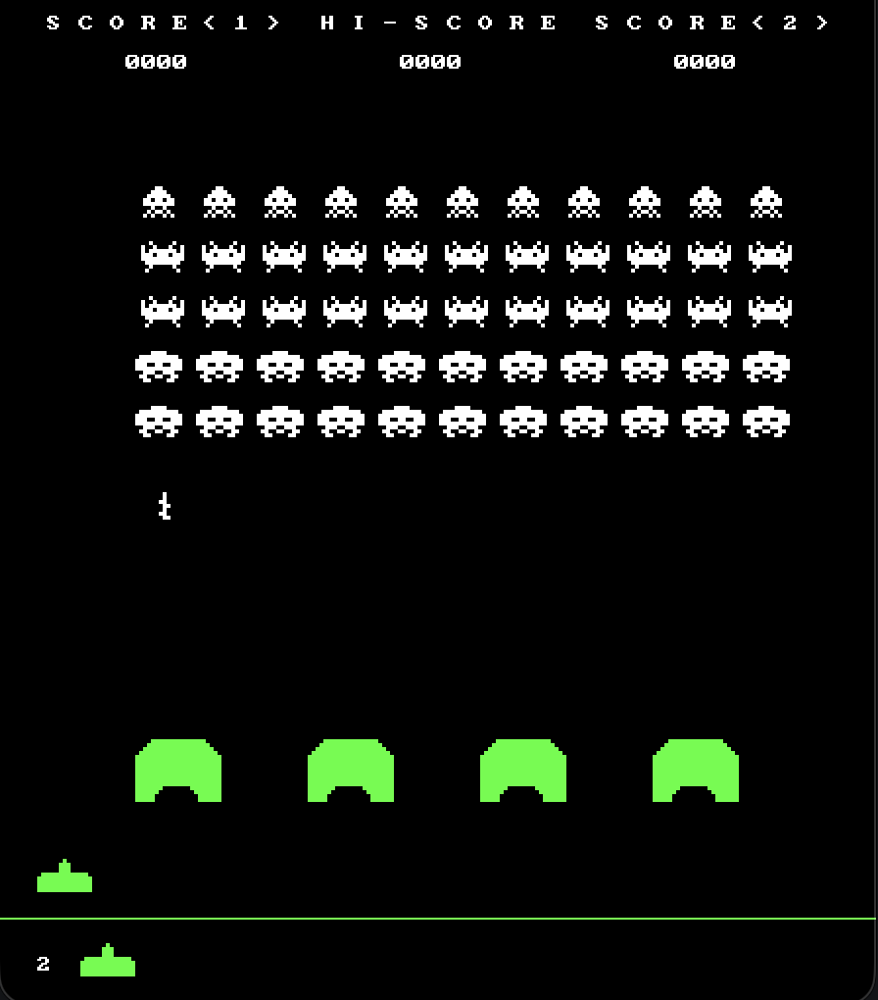

# space-invaders-c
Space invaders made in C - originally written as an app for [klika-os](https://github.com/ahamza1/klika-os), now a standalone game using [SDL2](https://www.libsdl.org/) that runs on macOS, Linux and Windows.
| | |
|---|---|
|||

## Controls

| Key         | Action                  |
|-------------|-------------------------|
| Enter       | Start / continue        |
| Left, Right | Move                    |
| Space       | Fire                    |
| Esc         | Quit                    |

## Building and running

You need a C compiler and the SDL2 development package. The game looks for the `assets/` folder in
the current directory first, then next to the executable.

### macOS

Install the Xcode command line tools (`xcode-select --install`) and [Homebrew](https://brew.sh), then:

```sh
brew install sdl2
make run
```

### Linux

```sh
# Debian / Ubuntu
sudo apt install build-essential libsdl2-dev

# Fedora
sudo dnf install gcc make SDL2-devel

# Arch
sudo pacman -S base-devel sdl2

make run
```

### Windows (MSYS2, recommended)

1. Install [MSYS2](https://www.msys2.org/).
2. Open the **MSYS2 UCRT64** shell and install the compiler, make and SDL2:

   ```sh
   pacman -S mingw-w64-ucrt-x86_64-gcc mingw-w64-ucrt-x86_64-SDL2 make
   ```

3. Build and run from the project folder:

   ```sh
   make run
   ```

The build copies `SDL2.dll` next to `invaders.exe`, so you can also start the game by double-clicking
`invaders.exe` in Explorer. To share the game, copy `invaders.exe`, `SDL2.dll` and the `assets` folder
together.

### Windows (Visual Studio)

Requires Visual Studio 2019 16.8 or newer with the "Desktop development with C++" workload, and
[vcpkg](https://learn.microsoft.com/vcpkg/get_started/get-started) for SDL2. From a
"Developer PowerShell for VS":

```powershell
vcpkg install sdl2:x64-windows
cmake -S . -B build-vs -DCMAKE_TOOLCHAIN_FILE="$env:VCPKG_ROOT/scripts/buildsystems/vcpkg.cmake"
cmake --build build-vs --config Release
.\build-vs\Release\invaders.exe
```

You can also open the folder in Visual Studio ("Open a local folder"), which picks up `CMakeLists.txt`
directly. CMake copies `SDL2.dll` and `assets/` next to the executable.

### CMake (any platform)

The Makefile is the simplest option on macOS, Linux and MSYS2, but CMake works everywhere too:

```sh
cmake -S . -B build-cmake
cmake --build build-cmake
./build-cmake/invaders
```

## Make targets

```sh
make        # build ./invaders (invaders.exe on Windows)
make run    # build and run
make clean  # remove build output
```

## Project layout

- `src/platform.c`, `include/platform.h` – SDL2 implementation of the window, input, drawing and BMP
  functions the game previously got from klika-os
- `src/`, `include/` – game code
- `assets/` – 32-bit BMP sprites
